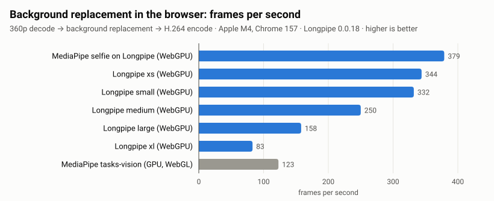
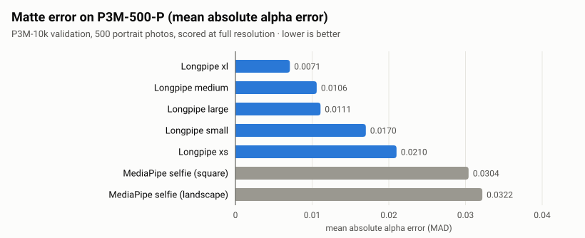

# Longpipe 🐉

Fast, high-quality video effects in the browser — virtual backgrounds, face touch-up, auto-reframe, and mic noise removal in one open-source SDK.


**Try the live demo → [longpipe.dev/demo](https://longpipe.dev/demo)**

> **Warning** — This project is very new and still under active development. Expect API changes between versions and bugs.

## Quick start

```
npm install longpipe
```

```ts
import { EffectsPipeline } from 'longpipe'

const stream = await navigator.mediaDevices.getUserMedia({ video: true, audio: true })

const pipeline = new EffectsPipeline(stream, {
  background: 'blur',   // or an image, video, or solid color
  touchup: true,        // skin smoothing
  reframe: true,        // auto-frame the subject
  audio: 'denoise',     // mic noise removal
})

videoEl.srcObject = pipeline.stream   // available immediately
await pipeline.ready                  // optional — resolves once the effect is live
```

`pipeline.stream` is wired synchronously and emits the unprocessed input until the model is ready (~1–3 s on cold start), so users see live video the whole time. Model weights stream from `cdn.longpipe.dev` by default — no extra setup, and [self-hostable](https://longpipe.dev/docs/self-hosting).

## Why Longpipe

- **One model, many effects.** Backgrounds, touch-up, and auto-reframe all run off a single shared encoder pass — enabling another effect doesn't cost another inference. Audio denoise runs in a parallel `AudioWorklet`, off the GPU entirely. ([Architecture](https://longpipe.dev/docs/architecture))
- **More accurate than MediaPipe's selfie segmenter at every preset, and faster at `xs`–`large`.** Custom-trained models running as hand-written WebGPU/WebGL shaders in a zero-copy, fully-GPU pipeline. See the [benchmarks](#benchmarks-vs-mediapipe).
- **Works everywhere.** Chromium, Firefox, and Safari (desktop + iOS). WebGPU when available, WebGL2 fallback, per-browser frame transport handled internally.
- **Adapts to the device.** Five model presets (`xs`–`xl`); autotune benchmarks the actual device at init and an adaptive controller swaps presets at runtime to hold 30 fps — on 10-year-old netbooks and the latest MacBook Pro alike.
- **Production pedigree.** Built by the founder of [Vectorly](https://www.crunchbase.com/organization/vectorly), a commercial effects SDK acquired in 2021 — a ground-up redesign for the WebGPU era.

### Benchmarks vs MediaPipe





- **Speed:** a full 360p decode → background replacement → H.264 encode, measured on an Apple M4 in Chrome 157.
  Longpipe runs as shipped, including its optical-flow frames. MediaPipe's tasks-vision library has no WebGPU
  delegate, so its fastest GPU path is WebGL.
- **Quality:** mean absolute alpha error on [P3M-10k](https://github.com/JizhiziLi/P3M)'s P3M-500-P set.
  MediaPipe's model scores the same on any engine.

Methodology, caveats (including where MediaPipe's model is faster, on LiteRT.js), the 720p, WebGL and IoU results,
and scripts to reproduce everything: **[full analysis](analysis/README.md)**.

## Models

Longpipe runs one of two segmentation models through the same GPU pipeline (WebGPU / WebGL2 backends, zero-copy frame input, compositor, worker and transports):

| `model` | What it is | Background effects | Touch-up, auto-reframe | Flow stabilization | Presets / autotune |
|---|---|---|---|---|---|
| `'longpipe'` (default) | Longpipe's own hydranet, five tiers `xs`–`xl` | ✓ | ✓ | ✓ | ✓ |
| `'mediapipe-selfie'` | Google's [MediaPipe Selfie Segmenter](https://ai.google.dev/edge/mediapipe/solutions/vision/image_segmenter#selfie-model), square 256×256 or landscape 256×144 (picked from the output aspect; force with `'mediapipe-selfie-square'` / `'mediapipe-selfie-landscape'`) | ✓ | ✗ (throws) | ✗ | ✗ (one fixed model) |

```ts
const pipeline = new EffectsPipeline(stream, { model: 'mediapipe-selfie', background: 'blur' })
```

Use `'mediapipe-selfie'` if you specifically want MediaPipe's model, e.g. to match an existing MediaPipe deployment while getting Longpipe's pipeline. Longpipe's own models drive every effect from one encoder pass and are more accurate ([benchmarks](#benchmarks-vs-mediapipe)). The MediaPipe weights are Apache-2.0 (© Google) and are converted by [`scripts/convert_mediapipe_selfie.py`](scripts/convert_mediapipe_selfie.py); see [`third_party/mediapipe/NOTICE.md`](third_party/mediapipe/NOTICE.md). They are served from `cdn.longpipe.dev/models/mediapipe/selfie/v1/`, or from your `weightsBaseUrl` if you self-host.

## Documentation

Full docs live at **[longpipe.dev/docs](https://longpipe.dev/docs)**:

- [Getting started](https://longpipe.dev/docs/getting-started)
- [API reference](https://longpipe.dev/docs/api) — all `EffectsPipeline` options and methods
- [Architecture](https://longpipe.dev/docs/architecture) — the hydranet: one encoder, many heads
- [Backgrounds](https://longpipe.dev/docs/backgrounds) · [Touch-up](https://longpipe.dev/docs/touchup) · [Auto-reframe](https://longpipe.dev/docs/reframe) · [Audio denoise](https://longpipe.dev/docs/audio)
- [Presets & autotune](https://longpipe.dev/docs/presets)
- [Model layer](https://longpipe.dev/docs/model-layer) — drive the model directly, without the pipeline
- [Self-hosting weights](https://longpipe.dev/docs/self-hosting)
- [ONNX & other runtimes](https://longpipe.dev/docs/onnx)

Machine-readable for LLMs and agents: [`llms.txt`](https://longpipe.dev/llms.txt) · [`llms-full.txt`](https://longpipe.dev/llms-full.txt)

## Models (ONNX)

The trained models are also published as official ONNX exports (all five tiers, matting, face keypoints,
optical flow and the 478-point face mesh) for Python, native apps, servers and `onnxruntime-web`:

- **Hugging Face:** [huggingface.co/Longpipe/longpipe](https://huggingface.co/Longpipe/longpipe)
- **CDN:** `https://cdn.longpipe.dev/models/v/0.0.5/onnx/` (CORS-enabled)

Inputs, outputs and examples: [longpipe.dev/docs/onnx](https://longpipe.dev/docs/onnx).

## Roadmap

- [x] Background segmentation / virtual backgrounds
- [x] Background noise removal (audio, separate pipeline)
- [x] Face landmarks + touch-up
- [x] Multi-face support
- [x] Auto-reframe
- [ ] AR effects
- [ ] Lighting correction

## License

SDK source code **and** Longpipe's pre-trained model weights are MIT-licensed — see [LICENSE](LICENSE) and [WEIGHTS_LICENSE](WEIGHTS_LICENSE). You're free to self-host the weights inside other open-source or commercial projects under MIT-compatible terms. The optional MediaPipe selfie weights are Google's, under Apache-2.0 ([NOTICE](third_party/mediapipe/NOTICE.md)).

The weights were trained on permissively-licensed public datasets (P3M-10k, AISegment, COCO, OpenImages), Z-Image synthetics, and a custom webcam dataset collected with participants' explicit, informed consent. The full dataset list and provenance details: [longpipe.dev/docs/licensing](https://longpipe.dev/docs/licensing).
