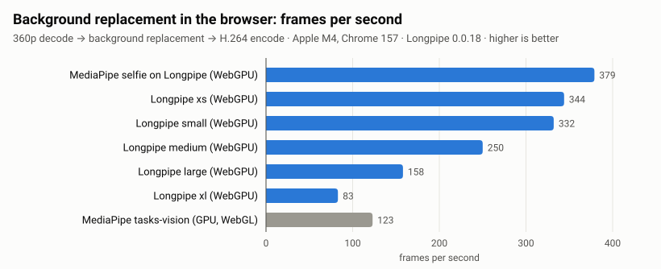
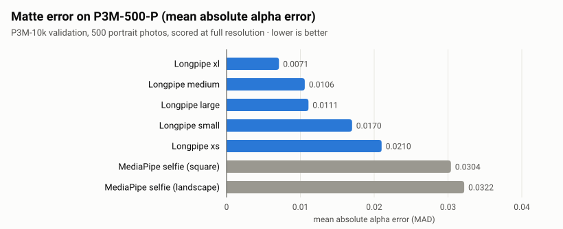

# Benchmarks: Longpipe vs MediaPipe

How Longpipe compares with Google's MediaPipe selfie segmenter, the default most web apps use for
virtual backgrounds, on speed and on matte quality. Every number here comes from code in
this folder that anyone can re-run: the scripts download pinned, hash-checked models, and the results
files record versions, hardware and every individual measurement. Read [`METHODOLOGY.md`](METHODOLOGY.md)
for the full details and caveats before quoting a number.

- [`quality/`](quality/): alpha-matte accuracy on the P3M-10k validation sets (Python, CPU).
- [`performance/`](performance/): speed in the browser (decode → background replacement → H.264 encode),
  as model × engine × pipeline.
- [`charts/`](charts/): the README charts and the script that draws them.

Three things decide how fast and how good a background effect is:

- **Model:** the neural network and its weights (MediaPipe selfie, or Longpipe's xs → xl presets).
- **Engine:** what runs the network in the browser. For MediaPipe that's its own
  `@mediapipe/tasks-vision` library; Longpipe has its own hand-written WebGPU/WebGL shaders.
- **Pipeline:** what happens around the network. Longpipe runs its full network on key frames
  and a small learned optical-flow network on the frames in between, plus a temporal stabiliser.

The tables compare what a developer gets out of the box: MediaPipe's tasks-vision library against
the Longpipe SDK as shipped. They also include MediaPipe's model running on Longpipe's engine
(`model: 'mediapipe-selfie'`, available since 0.0.17), to separate the engine from the model.

## Performance



Background replacement on a 192-frame webcam clip at **360p**, on an Apple M4 MacBook Pro with
Chrome 157, Longpipe 0.0.18. Frames per second for the full transcode (WebCodecs decode → effect →
H.264 encode), median of interleaved runs. Higher is better.

| Model and engine | WebGPU | WebGL |
|---|---:|---:|
| MediaPipe selfie (landscape), tasks-vision GPU delegate | – | 123\* |
| MediaPipe selfie (landscape), Longpipe engine | 379 | 127 |
| Longpipe xs | 344 | 182 |
| Longpipe small | 332 | 188 |
| Longpipe medium | 250 | 153 |
| Longpipe large | 158 | 97 |
| Longpipe xl | 83 | 59 |

MediaPipe's tasks-vision library has no WebGPU delegate. Its GPU delegate runs on WebGL.

Longpipe rows are from the 0.0.18 A/B session (3 rounds,
[`engine-perf-ab-transcode.json`](performance/results/2026-11-15-apple-m4-engine-perf-ab-transcode.json));
0.0.18 records each model run and frame into one GPU command buffer. \*tasks-vision is from the v2 session on
the same machine and harness (5 rounds,
[`2026-11-15-apple-m4-v2.md`](performance/results/2026-11-15-apple-m4-v2.md)), which also has
LiteRT.js: running MediaPipe's model, it is still the fastest engine tested (433 fps landscape at 360p).

The Longpipe rows run the SDK's own renderer, exactly as shipped:
- **xs:** the full network on every 3rd frame, the flow network on the other two.
- **small and medium:** the full network on every 2nd frame, the flow network on the others.
- **large and xl:** both networks on every frame.

The harness counts these runs to confirm the schedule. The 720p results, MediaPipe's CPU delegate,
LiteRT.js and the run-to-run spread are in
[`benchmarks/performance/results/2026-11-15-apple-m4-v2.md`](performance/results/2026-11-15-apple-m4-v2.md).

### Code

Commands: [Quick start](#quick-start).

- [`benchmarks/performance/web/src/pipelines.js`](performance/web/src/pipelines.js):
  each pipeline, all with the same `process(VideoFrame) → VideoFrame` interface.
- [`benchmarks/performance/tools/bench.mjs`](performance/tools/bench.mjs): the runner.

Every pipeline uses the same output stage, so the comparison measures only the effect. Your numbers
will differ on other hardware and browsers; the ordering is what to compare.

## Quality



Matte accuracy on the [P3M-10k](https://github.com/JizhiziLi/P3M) validation sets: 1,000 portrait
photos with hand-labelled alpha mattes. Each image is scored at full resolution with the P3M paper's
own metric code.

- **MAD:** mean absolute alpha error. Lower is better.
- **IoU:** overlap of the mask thresholded at 0.5. Higher is better.

| Model | Mask resolution | P3M-500-P MAD | P3M-500-NP MAD | P3M-500-P IoU | P3M-500-NP IoU |
|---|---|---:|---:|---:|---:|
| Longpipe xs | 384×240 | 0.0210 | 0.0233 | 0.923 | 0.926 |
| Longpipe small | 384×224 | 0.0170 | 0.0155 | 0.937 | 0.954 |
| Longpipe medium | 512×320 | 0.0106 | 0.0102 | 0.966 | 0.972 |
| Longpipe large | 640×400 | 0.0111 | 0.0100 | 0.963 | 0.972 |
| Longpipe xl | 1280×768 | **0.0071** | **0.0080** | **0.977** | **0.979** |
| MediaPipe selfie (square) | 256×256 | 0.0304 | 0.0249 | 0.923 | 0.940 |
| MediaPipe selfie (landscape) | 256×144 | 0.0322 | 0.0276 | 0.917 | 0.934 |

MediaPipe's model scores the same on either engine: Longpipe's implementation matches Google's
TFLite reference to within 1.4e-5 (f32).

- **Every Longpipe preset has a lower matte error than MediaPipe.**
- **On IoU,** MediaPipe's square model beats xs on P3M-500-NP and ties it on P3M-500-P. Small and
  up beat it.

Two notes on fairness:
- MediaPipe selfie is a segmentation model, scored here on a matting task. That's deliberate: a
  virtual background shows the matte, so matte quality is what users see.
- Longpipe was trained on P3M-10k's (face-blurred) training split, so **P3M-500-NP is the cleaner
  comparison.**

This test is single images, so it doesn't measure temporal stability (flicker), which is what
Longpipe's flow pipeline is for.

### Code

Commands: [Quick start](#quick-start); the dataset isn't in this repo ([Getting P3M-10k](#getting-p3m-10k)).

[`benchmarks/quality/eval_p3m.py`](quality/eval_p3m.py) runs Longpipe through
its official ONNX exports and MediaPipe through Google's `mediapipe` Python package, using the same
`.tflite` file as the web library. Full metrics (SAD, MSE, gradient, connectivity) are in
[`benchmarks/quality/results/2026-11-15-p3m.md`](quality/results/2026-11-15-p3m.md).

## Charts

`python3 benchmarks/charts/charts.py` regenerates `charts/speed-360p.svg` and `charts/quality-p3m.svg` from the numbers above.

## Quick start

### Quality

Requirements: Python 3.10+ (results were produced with 3.12), ~6 GB of disk for
the dataset, no GPU.

```sh
cd benchmarks/quality
python3 -m venv .venv && . .venv/bin/activate
pip install -r requirements.txt          # numpy pillow scipy onnxruntime mediapipe huggingface_hub

python eval_p3m.py --p3m-root /path/to/P3M-10k --limit 10    # quick check: 10 images per set
python eval_p3m.py --p3m-root /path/to/P3M-10k               # full run (~8 min on 8 CPU cores)
python eval_p3m.py --p3m-root /path/to/P3M-10k --protocol legacy-readme   # the old README chart's protocol
```

Options: `--methods longpipe-xl mediapipe-square …`, `--sets P3M-500-NP`,
`--workers N` (default: min(8, CPU count)), `--hf-revision` (default: the pinned
revision the published results used), `--out-dir`, `--tag`.

Writes `results/<date>-p3m.{md,json}` and a per-image `…-per-image.csv.gz`.
Models are cached in `quality/.cache/` (Longpipe ONNX from Hugging Face, ~150 MB
for all five presets; MediaPipe `.tflite` from Google, checked by sha256).

### Performance

Requirements: Node 20+, Google Chrome (or set `CHROME=/path/to/chrome`), a GPU.

```sh
cd benchmarks/performance
npm install                    # also downloads the test clip, MediaPipe models and Longpipe weights (sha256-checked)

npm run bench -- --check       # sanity-check every pipeline's output first
npm run bench                  # 360p + 720p transcode, every pipeline, 5 interleaved rounds
npm run bench -- --modes process,model --runs 3          # diagnostics
npm run bench -- --samples 360p --pipelines passthrough,shipped-webgpu-small,litert-webgpu,mediapipe-gpu
node tools/report.mjs s1=results/<file>.json [s2=results/<file2>.json]   # markdown tables
node tools/ceiling.mjs --headless  # output-path investigation (see METHODOLOGY.md)
node tools/profile.mjs configs.json out.json   # per-dispatch GPU profile of one network (see below)
```

`tools/profile.mjs` (page `web/profile.html`, code `web/src/profile.js`) builds
one network from this repo's `src/` (or LiteRT.js) and reports latency,
back-to-back throughput, CPU time per run, queue submits / passes / dispatches
per run, and each dispatch's GPU time from timestamp queries (headless Chrome
with `--enable-webgpu-developer-features`). `configs.json` is a list such as
`[{"impl":"longpipe","backend":"webgpu","net":"mp-square","dtype":"f16"},
{"impl":"litert","net":"mp-square"}]`; `net` is `mp-square`, `mp-landscape` or
a tier; `"frame": {"w": 640, "h": 360}` profiles the whole per-frame path
(Input → network → RenderOp) instead; `"exclude": {"name": "<label regex>"}`
also reports the one-pass GPU time without those dispatches (what fusing them
away could save at most).

Add `--headless` to run without a window (fine on macOS; on Linux see
METHODOLOGY.md). `--output direct` hands canvas frames straight to the encoder
instead of the readback stage (see METHODOLOGY.md, "Output path").
`--busy-cmd '<command>'` discards and repeats any measurement that overlapped a
moment when the command exited 0 (e.g. a background GPU job is running). Or run
`npm run dev` and open http://localhost:5174 to pick pipelines and run them in
your own browser, then **Download JSON**.

Pipeline names: `passthrough`, `canvas-copy-{webgpu,webgl}` (ceilings);
`mediapipe-{gpu,cpu}[-landscape]` (MediaPipe Tasks); `litert-webgpu[-landscape]`
(LiteRT.js); `lp-mediapipe-{webgpu,webgl}-{square,landscape}` (MediaPipe model on
Longpipe's engine); `longpipe-{webgpu,webgl}-{xs,small,medium,large,xl}[-f32]`
(network every frame); `shipped-{webgpu,webgl}-{xs,…,xl}` (the SDK's own
renderer, as shipped).

Close other apps, plug in power, and check the passthrough and canvas-copy rows:
they show how much of the frame budget the decoder/output path/encoder leave on
your machine.

## Getting P3M-10k

P3M-10k is published by its authors (Li et al., University of Sydney) for
research use, under a dataset release agreement (the agreement states an MIT
license, requires citing the P3M paper in work that uses the dataset, and notes
that the image copyrights stay with their original owners). It is **not** included
in this repository and must not be committed to it, not even as example images.

1. Read the release agreement:
   [P3M-10k_Dataset_Release_Agreement.pdf](https://jizhizili.github.io/files/p3m_dataset_agreement/P3M-10k_Dataset_Release_Agreement.pdf).
   The authors ask that you only download the dataset if you agree to it.
2. Download **`P3M-10k.zip`** (~5.4 GB) from the link in the
   ["PPT Setting and P3M-10k Dataset"](https://github.com/JizhiziLi/P3M#ppt-setting-and-p3m-10k-dataset)
   section of [github.com/JizhiziLi/P3M](https://github.com/JizhiziLi/P3M):
   Google Drive, or Baidu Wangpan (password given there).
3. Unzip it anywhere. Use the extracted `P3M-10k` folder, unchanged, as
   `--p3m-root`:

```
P3M-10k/                       ← pass this folder as --p3m-root
├── train/                     (not used by the benchmark)
│   ├── blurred_image/
│   └── mask/
├── validation/
│   ├── P3M-500-P/
│   │   ├── blurred_image/     500 × .jpg   (face-blurred)
│   │   ├── mask/              500 × .png   (alpha matte)
│   │   └── trimap/            500 × .png
│   └── P3M-500-NP/
│       ├── original_image/    500 × .jpg   (not blurred)
│       ├── mask/              500 × .png
│       └── trimap/            500 × .png
├── train_list.txt
├── P3M-500-P_list.txt
├── P3M-500-NP_list.txt
├── P3M-10k_Release_Agreement.pdf
└── readme.txt
```

Only `validation/` is read. The script stops with an explanation if a folder is
missing, and prints the number of images it found in each set (500 + 500, of
which 499 are landscape) before evaluating.

Please cite the dataset if you publish results from it:

> Jizhizi Li, Sihan Ma, Jing Zhang, and Dacheng Tao. "Privacy-Preserving Portrait
> Matting." ACM MM 2021.

## Credits

The performance harness is adapted from the
[webrtcHacks WebGPU segmentation benchmark](https://github.com/sb2702/webrtc-hacks-webgpu/tree/main/segmentation)
(MIT), including its MediaPipe pipelines, frame I/O shaders, timing code and test
clip. MediaPipe models © Google, Apache 2.0.
